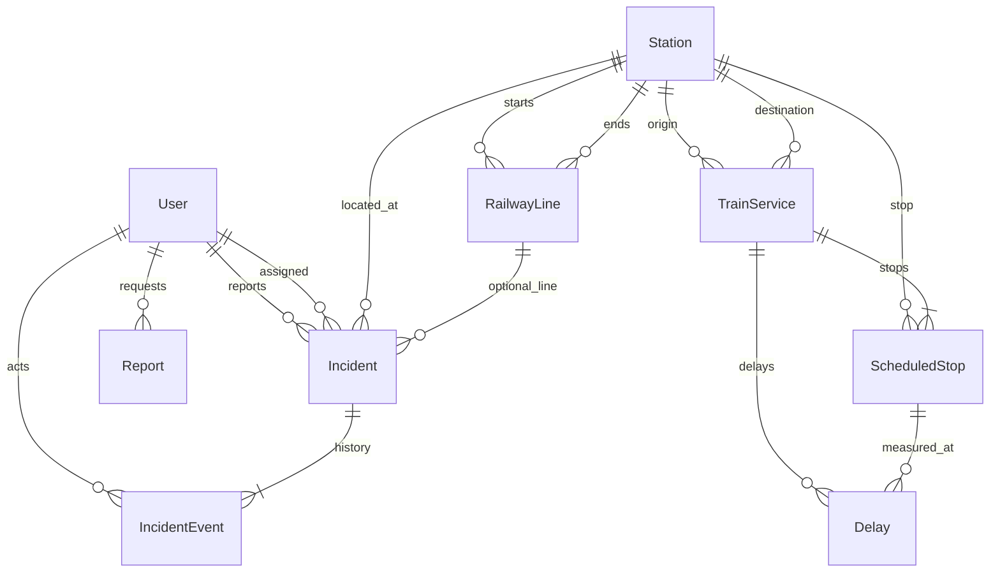

# RailOps database design (initial)

**Status:** Phase 0 logical model. No migrations until Phase 1 (user) and later phases (domain apps).  
**Database:** PostgreSQL with PostGIS. SQLite is **not** an integration-test substitute.

## 1. Conventions

- UUID primary keys for operational entities (stations, lines, incidents, events, services, delays, sync runs, reports). Django `User` keeps an integer PK unless a later requirement forces UUID (not justified now).
- Explicit `related_name` on every FK.
- Timezone-aware datetimes (`USE_TZ=True`).
- `UniqueConstraint` / `CheckConstraint` in `Meta.constraints`, not only application checks.
- Prefer deactivate (`is_active=False`) over `DELETE` for infrastructure referenced by operations.
- `on_delete` chosen for audit and referential integrity, not convenience.

## 2. Entity-relationship overview



`ExternalSyncRun` is independent (integration audit). `Report` is independent except `requested_by` → User.

## 3. Entities

### 3.1 User (`accounts.User`, `AbstractUser`)

| Field | Notes |
|---|---|
| Django auth fields | username, password hash, email, flags |
| `email` | unique when non-blank (`accounts_user_unique_email` partial unique constraint); blank emails are allowed more than once |
| `created_at` / `updated_at` | auto |
| `is_active` | already on `AbstractUser`; do not duplicate |

Roles are **Groups** (Administrator, Dispatcher, Viewer), not a custom role enum on the user.

Must exist **before** the first migration.

### 3.2 Station

| Field | Type | Notes |
|---|---|---|
| id | UUID PK | |
| name | CharField | required |
| code | CharField | **unique** |
| city | CharField | required |
| location | PointField | SRID 4326, geography=True |
| is_active | Boolean | default True |
| created_at / updated_at | DateTime | |

**Indexes:** unique on `code`; GIST on `location` (GeoDjango spatial index). Optional btree on `(is_active, name)` for list pages.

**Delete:** `PROTECT` from incidents, scheduled stops, and as start/end of a railway line. Deactivate instead.

**Spatial queries:** `dwithin` for radius; distance order for nearest.

### 3.3 RailwayLine

| Field | Type | Notes |
|---|---|---|
| id | UUID PK | |
| name | CharField | |
| code | CharField | unique |
| start_station | FK Station | `PROTECT`, related_name `lines_starting` |
| end_station | FK Station | `PROTECT`, related_name `lines_ending` |
| geometry | LineStringField optional | SRID 4326; **not** derived from stations |
| is_active | Boolean | |
| created_at / updated_at | DateTime | |

A line is not a list of intermediate stations in MVP (can be added later via an explicit M2M). Geometry is stored only if provided; missing geometry is valid.

### 3.4 Incident

| Field | Type | Notes |
|---|---|---|
| id | UUID PK | |
| title | CharField | |
| description | TextField | |
| station | FK Station | `PROTECT`, required |
| railway_line | FK RailwayLine | `SET_NULL`, optional |
| category | CharField/TextChoices | infrastructure, technical_failure, signal_failure, track_obstruction, weather, operational_delay, other |
| severity | TextChoices | low, medium, high, critical |
| status | TextChoices | open, in_progress, resolved, closed |
| reporter | FK User | `PROTECT` |
| assigned_to | FK User | `SET_NULL`, optional |
| reported_at | DateTime | set on create |
| updated_at | DateTime | |
| resolved_at | DateTime | null until resolved; **cleared on reopen** |

**Indexes:** `(status, severity)`, `(station, reported_at DESC)`, `reported_at`, assigned_to for inbox-style lists.

**Check:** if needed, `resolved_at IS NULL OR status IN ('resolved','closed')` — keep in sync in the service; a CheckConstraint is desirable if it does not fight reopen.

### 3.5 Incident status transitions

Allowed for MVP (service-enforced; not a free form):

```text
OPEN ──► IN_PROGRESS ──► RESOLVED ──► CLOSED
              ▲               │
              └───────────────┘  reopen (clears resolved_at)
```

| From | To | Extra |
|---|---|---|
| open | in_progress | |
| in_progress | resolved | set `resolved_at` |
| in_progress | open | rare rollback; event recorded |
| resolved | closed | keep `resolved_at` |
| resolved | in_progress | reopen; `resolved_at = NULL` |
| closed | — | terminal for dispatcher/viewer; administrator reopen to `in_progress` only if we add an explicit permission in Phase 4 |

Invalid transitions raise a domain error; no silent coerce.

### 3.6 IncidentEvent (immutable)

| Field | Type | Notes |
|---|---|---|
| id | UUID PK | |
| incident | FK | `CASCADE` |
| actor | FK User | `PROTECT` (preserve who did it) |
| event_type | TextChoices | created, status_changed, severity_changed, assigned, resolved, comment |
| previous_status / new_status | nullable | |
| description | TextField | |
| created_at | DateTime | no `updated_at`; no update/delete in UI or API |

Writes **only** through incident services. No ModelForm for events.

### 3.7 TrainService

| Field | Type | Notes |
|---|---|---|
| id | UUID PK | |
| external_id | CharField | provider key |
| train_number | CharField | |
| origin / destination | FK Station | `PROTECT` |
| service_date | Date | local operating day |
| source | CharField | mock, csv, or provider name |
| imported_at | DateTime | |

**Unique:** `(external_id, service_date)` — idempotent sync.

### 3.8 ScheduledStop

| Field | Type | Notes |
|---|---|---|
| id | UUID PK | |
| train_service | FK | `CASCADE` |
| station | FK | `PROTECT` |
| stop_sequence | PositiveInt | |
| scheduled_arrival / scheduled_departure | DateTime nullable | timezone-aware |
| actual_arrival / actual_departure | DateTime nullable | |

**Unique:** `(train_service, stop_sequence)`. Overnight: datetimes include the calendar date, not “time-only” fields.

### 3.9 Delay — derivation vs storage

**Meaning:**

| Concept | Source |
|---|---|
| Scheduled time | `ScheduledStop.scheduled_*` |
| Actual time | `ScheduledStop.actual_*` |
| Delay | `actual - scheduled` in **seconds** (signed: negative = early) |

**Storage rule:** persist a `Delay` row when an actual timestamp exists for the measured event (MVP: **arrival** if both exist, else the one that exists; document the chosen event on the row via `source` or a small `kind` field `arrival`/`departure`). Do **not** store a delay of 0 for missing actuals.

| Field | Type | Notes |
|---|---|---|
| id | UUID PK | |
| train_service | FK | `CASCADE` (query convenience; still tied to stop) |
| scheduled_stop | FK | `CASCADE` |
| delay_seconds | Integer | signed |
| recorded_at | DateTime | |
| source | CharField | import, calculated, manual |

**Unique:** `(scheduled_stop, kind)` so re-import **updates** rather than duplicates. Recalculation overwrites `delay_seconds`.

Dashboard “delayed services”: distinct services with any delay_seconds **> 300** (on-time threshold). Early trains are not delayed.

### 3.10 ExternalSyncRun

| Field | Type | Notes |
|---|---|---|
| id | UUID PK | |
| integration_name | CharField | |
| started_at / finished_at | DateTime | |
| status | TextChoices | running, success, failed, partial |
| records_processed / created / updated | Integer | |
| error_summary | TextField | truncated, no secrets, no full payloads |

### 3.11 Report

| Field | Type | Notes |
|---|---|---|
| id | UUID PK | |
| report_type | CharField | e.g. monthly_operations |
| period_start / period_end | Date | validated max span |
| requested_by | FK User | `PROTECT` |
| status | TextChoices | pending, success, failed |
| generated_at | DateTime nullable | |
| file | FileField | storage backend, not git |
| error_summary | TextField | |

Never store PDF bytes in PostgreSQL.

## 4. `on_delete` summary

| FK | Behaviour |
|---|---|
| Incident.station, TrainService stations, ScheduledStop.station, RailwayLine endpoints | `PROTECT` |
| Incident.railway_line, Incident.assigned_to | `SET_NULL` |
| Incident.reporter, IncidentEvent.actor, Report.requested_by | `PROTECT` |
| IncidentEvent.incident, ScheduledStop.train_service, Delay FKs | `CASCADE` |

## 5. Index intent (not speculative)

| Index | Why |
|---|---|
| Station.code unique | Lookup and import matching |
| Station.location GIST | Radius / nearest |
| Incident (status, reported_at) | Ops queues |
| Incident station + time | Station detail |
| TrainService (external_id, service_date) unique | Idempotent import |
| ScheduledStop (service, sequence) unique | Stop order |
| Delay (scheduled_stop, kind) unique | Idempotent delay upsert |
| ExternalSyncRun started_at | Ops list |
| Report (requested_by, generated_at) | User’s reports |

Do not index every FK blindly; add when list/filter queries exist.

## 6. Implementation order

1. Custom user + groups (Phase 1–2).  
2. Station, RailwayLine (Phase 3).  
3. Incident, IncidentEvent (Phase 4).  
4. TrainService, ScheduledStop, Delay, ExternalSyncRun (Phase 5).  
5. Report (Phase 9).
